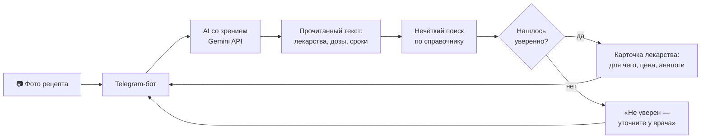

# 💊 ReceptAI · Рецепт оқитын AI

**Telegram-бот на искусственном интеллекте: читает рецепт или назначение врача по фото и объясняет понятным языком, что за лекарство, как его принимать, сколько оно стоит и есть ли аналог дешевле.**

> Дәрігердің рецептін фото арқылы оқып, қандай дәрі екенін, қалай қабылдау керегін, бағасын және арзан баламаларын түсінікті тілде түсіндіретін AI Telegram-бот.

| | |
|---|---|
| Конкурс | INNOFEST Kyzylorda 2026 (4–5 декабря), направление **AI Software Development** |
| Автор | Алимжан, школа программирования GRAND master |
| Наставник | Куанышбаев А. Ж. |
| Статус | 🛠 в разработке, готовность к 3 декабря 2026 |

---

## 1. Проблема

Каждый, кто получал рецепт в поликлинике, знает эту ситуацию:

- **почерк врача не прочитать**, особенно названия лекарств и дозировки, а иногда не разбирает и аптекарь;
- **непонятно, что за лекарство** и от чего оно: в назначении сокращения и латынь;
- **непонятна цена.** Одно и то же лекарство в разных аптеках стоит по-разному, а аналог с тем же действующим веществом может быть в 2–3 раза дешевле. Но обычный человек об этом не знает;
- **пожилым людям тяжелее всех:** мелкий шрифт, инструкции на русском, спросить некого.

Ошибка в названии или дозировке — это риск для здоровья, а переплата бьёт по семейному бюджету.

## 2. Решение

Человек фотографирует рецепт и отправляет боту. Через несколько секунд бот отвечает:

```
📄 В рецепте найдено 2 лекарства:

1. Атропин — глазные капли 1%
   Для чего: расширение зрачка при осмотре и лечении глаз
   Как написал врач: по 1 капле 2 раза в день, 7 дней
   💰 Предельная цена в РК: ... тг
   💊 Аналоги с тем же веществом: ...

2. ...

⚠️ Слово во 2-й строке прочитано неуверенно — уточните у врача или фармацевта.
ℹ️ Бот объясняет, что написано в рецепте. Это не замена консультации врача.
```

Бот работает на **казахском и русском** языках.

## 3. Возможности

| Команда / действие | Что происходит |
|---|---|
| `/start` | Приветствие, выбор языка (қазақша / русский), инструкция |
| Фото рецепта | Список лекарств: название, для чего, как принимать, цена, аналоги |
| Неуверенное распознавание | Бот честно пишет, какое слово не уверен, и просит уточнить у врача |
| `/help` | Как правильно сфотографировать рецепт |
| `/about` | Откуда данные и почему бот не заменяет врача |

## 4. Как это работает



### 4.1. AI читает почерк

Обычные программы распознавания текста (OCR) врачебный почерк не читают. Поэтому фото отправляется **модели искусственного интеллекта со зрением**: она видит изображение целиком и понимает контекст рецепта. Мы просим её вернуть ответ в строгом формате JSON:

```json
[
  {"name": "Атропин", "form": "капли глазные 1%", "dose": "1 капля",
   "frequency": "2 раза в день", "duration": "7 дней", "sure": true}
]
```

Если модель не может прочитать слово, она должна поставить `null` и `"sure": false`, а **не угадывать**.

### 4.2. Своя проверка — главная часть проекта

AI может ошибиться: прочитать «Азотроп» вместо настоящего названия. Поэтому программа **не верит AI на слово**:

1. Прочитанное название сравнивается со **справочником лекарств** (`data/drugs.csv`) с помощью **нечёткого поиска** (библиотека rapidfuzz). Она находит самое похожее настоящее название даже с опечатками.
2. Если похожесть ≥ 85%, лекарство найдено, бот показывает его карточку.
3. Если меньше, бот пишет: «Не уверен, возможно это … — уточните у врача или фармацевта».

Так AI отвечает за чтение, а справочник и проверка отвечают за то, чтобы бот **не выдумывал** лекарства.

### 4.3. Справочник лекарств

Файл `data/drugs.csv` собирается вручную из официальных источников:

| Поле | Пример | Источник |
|---|---|---|
| Торговое название | Атропин | Государственный реестр ЛС (НЦЭЛС, ndda.kz) |
| Действующее вещество (МНН) | атропин | Государственный реестр ЛС |
| Форма | капли глазные 1% | Государственный реестр ЛС |
| Для чего (1 строка) | расширение зрачка | Официальная инструкция |
| Предельная цена, тг | … | Перечень предельных цен, Минздрав РК |

**Аналоги** — лекарства с тем же действующим веществом (МНН) и той же формой. Бот показывает их с ценой, чтобы человек мог спросить в аптеке о более дешёвом варианте.

## 5. Технологии

| Часть | Технология | Зачем |
|---|---|---|
| Язык | Python 3.11 | Основной язык проекта |
| Бот | pyTelegramBotAPI | Простая библиотека для Telegram-ботов |
| AI со зрением | Gemini API (Google AI Studio) | Чтение рукописного рецепта по фото |
| Нечёткий поиск | rapidfuzz | Исправление ошибок распознавания по справочнику |
| Справочник | CSV + модуль csv | Лекарства, вещества, цены |
| Настройки | python-dotenv | Ключи хранятся в `.env`, а не в коде |

Бюджет проекта: **0 тг**. Используется бесплатный уровень Gemini API.

## 6. Безопасность и этика

Проект про здоровье, поэтому правила жёсткие:

1. **Бот не лечит и не даёт медицинских советов.** Он объясняет, что написано в рецепте, и показывает официальные данные. В каждом ответе: «Это не замена консультации врача».
2. **Бот никогда не угадывает дозировку.** Если не уверен, так и пишет и отправляет к врачу или фармацевту.
3. **Аналог — только подсказка:** «замену согласуйте с врачом или фармацевтом».
4. **Фото рецептов не сохраняются.** В рецепте есть ФИО и диагноз, фото обрабатывается и сразу удаляется.
5. **Для тестов и демо не используются настоящие рецепты пациентов.** Тестовые рецепты пишут от руки взрослые (учителя, родители). На бесплатном уровне Gemini запросы могут использоваться Google для улучшения сервиса, поэтому реальные медицинские данные туда не отправляем.
6. **Ключи** (`BOT_TOKEN`, `GEMINI_API_KEY`) только в `.env`, файл в `.gitignore`, в репозитории только `.env.example`.

## 7. Результаты

*Заполняется на этапе «Доводка».*

Проверка на **30 тестовых рецептах**, написанных от руки разными людьми:

| Метрика | Цель | Результат |
|---|---|---|
| Названия лекарств распознаны правильно | ≥ 80% | — |
| Выдуманные лекарства (нет в рецепте, но бот назвал) | 0 | — |
| Неуверенные слова честно отмечены | 100% | — |
| Время ответа | ≤ 10 с | — |
| Лекарств в справочнике | ≥ 100 | — |

## 8. Установка и запуск

**Нужно:** Python 3.11, Git, аккаунт Telegram, бесплатный ключ Gemini API ([aistudio.google.com](https://aistudio.google.com/)).

```bash
# 1. Скачать проект
git clone https://github.com/schoolprogramminggm-lab/ReceptAI.git
cd ReceptAI

# 2. Виртуальное окружение
python -m venv venv
venv\Scripts\activate

# 3. Библиотеки
pip install -r requirements.txt

# 4. Настройки
copy .env.example .env
```

Файл `.env`:
```
BOT_TOKEN=токен_от_@BotFather
GEMINI_API_KEY=ключ_из_Google_AI_Studio
MATCH_THRESHOLD=85
```

```bash
# 5. Запуск
python bot/main.py
```

## 9. Структура проекта

```
ReceptAI/
├── bot/
│   ├── main.py            # запуск бота
│   ├── handlers.py        # /start, /help, /about, приём фото
│   └── texts.py           # тексты бота на kk / ru
├── ai/
│   ├── reader.py          # отправка фото в Gemini, ответ в JSON
│   └── prompt.txt         # инструкция для AI: что читать, как отвечать
├── drugs/
│   ├── search.py          # нечёткий поиск по справочнику
│   └── analogs.py         # аналоги по действующему веществу
├── data/
│   └── drugs.csv          # справочник лекарств
├── tests/
│   ├── prescriptions.csv  # правильные ответы для 30 тестовых рецептов
│   └── test_search.py     # проверка нечёткого поиска
├── test_photos/           # фото тестовых рецептов (не в git)
├── .env.example
├── requirements.txt
└── README.md
```

## 10. План работы

Задачи ведутся в [Issues](../../issues) и разбиты по [этапам (Milestones)](../../milestones):

| Этап | Срок | Результат |
|---|---|---|
| 1. ТЗ и старт | до 7 ноября | Окружение, ключ Gemini, первое чтение фото рецепта |
| 2. Прототипы | до 14 ноября | 30 тестовых рецептов, справочник 100 лекарств, бот принимает фото |
| 3. Разработка | до 21 ноября | AI читает рецепт в боте, нечёткий поиск, карточки лекарств с ценой и аналогами |
| 4. Доводка | до 28 ноября | Точность на 30 рецептах, безопасность, слайды, видео-демо |
| 5. Защита | до 3 декабря | Репетиции, выступление 3 минуты |

**Правила работы:**
1. Каждое занятие начинается с отчёта на 2 минуты: что сделал, что делаю сегодня.
2. Коммит в конце каждого занятия с понятным описанием.
3. Наставник проверяет задачи в конце занятия.
4. Всё, что показываем на сцене, работает вживую. Видео-демо только запасной вариант.

## 11. Демонстрация на INNOFEST

Член жюри пишет от руки «рецепт» неразборчивым почерком, как врач, фотографирует его и отправляет боту. Бот расшифровывает лекарства, объясняет их назначение и показывает цену и аналоги. Если слово прочитать нельзя, бот честно говорит, что не уверен.

---

*Проект подготовлен в школе программирования GRAND master, Кызылорда, 2026.*
