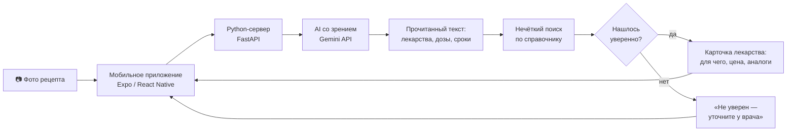

# 💊 ReceptAI · Рецепт оқитын AI

**Мобильное приложение на искусственном интеллекте: фотографируете рецепт врача, приложение читает его и объясняет — что за лекарство, как принимать, сколько стоит и есть ли аналог дешевле.**

> Дәрігердің рецептін фото арқылы оқып, қандай дәрі екенін, қалай қабылдау керегін, бағасын және арзан баламаларын түсінікті тілде түсіндіретін AI мобильді қолданба.

| | |
|---|---|
| Конкурс | INNOFEST Kyzylorda 2026 (4–5 декабря), направление **AI Software Development** |
| Автор | Алимжан, школа программирования GRAND master |
| Наставник | Куанышбаев А. Ж. |
| Статус | 🛠 в разработке, готовность к 3 декабря 2026 |

---

## 1. Проблема

Когда человек приходит от врача с рецептом, у него часто возникают вопросы, а спросить уже некого. Я спросил у родных, и почти у всех была такая история.

- **Почерк не прочитать.** Врачи пишут быстро, и название лекарства или дозировку бывает невозможно разобрать. Иногда не может прочитать даже аптекарь, и человеку приходится возвращаться в поликлинику.
- **Непонятно, что это за лекарство.** В рецепте сокращения и слова на латыни. Человек не знает, от чего это лекарство и как его правильно пить: до еды или после, сколько дней.
- **Непонятна цена.** В разных аптеках одно и то же лекарство стоит по-разному. А лекарство с тем же действующим веществом может стоить в 2–3 раза дешевле, но об этом мало кто знает, и люди переплачивают.
- **Пожилым людям сложнее всех.** У бабушек и дедушек плохое зрение, мелкий шрифт в инструкции трудно читать, а дети и внуки не всегда рядом, чтобы помочь.

Ошибка в названии лекарства или в дозировке опасна для здоровья, а переплата бьёт по семейному бюджету. Поэтому я хочу сделать приложение, которое поможет понять рецепт. При этом **приложение не лечит и не заменяет врача** — оно только объясняет, что написано в рецепте, и советует уточнить у врача или фармацевта, если не уверено.

## 2. Решение

Человек фотографирует рецепт прямо в приложении. Через несколько секунд экран показывает:

```
📄 В рецепте найдено 2 лекарства:

1. Атропин — глазные капли 1%
   Для чего: расширение зрачка при осмотре и лечении глаз
   Как написал врач: по 1 капле 2 раза в день, 7 дней
   💰 Предельная цена в РК: ... тг
   💊 Аналоги с тем же веществом: ...

2. ...

⚠️ Слово во 2-й строке прочитано неуверенно — уточните у врача или фармацевта.
ℹ️ Это не замена консультации врача.
```

Приложение работает на **казахском и русском** языках.

## 3. Как это работает



### 3.1. AI читает почерк

Обычные программы распознавания текста (OCR) врачебный почерк не читают. Поэтому фото отправляется **модели искусственного интеллекта со зрением**: она видит изображение целиком и понимает контекст рецепта. Мы просим её вернуть ответ в строгом формате JSON:

```json
[
  {"name": "Атропин", "form": "капли глазные 1%", "dose": "1 капля",
   "frequency": "2 раза в день", "duration": "7 дней", "sure": true}
]
```

Если модель не может прочитать слово, она должна поставить `null` и `"sure": false`, а **не угадывать**.

### 3.2. Своя проверка — главная часть проекта

AI может ошибиться: прочитать «Азотроп» вместо настоящего названия. Поэтому программа **не верит AI на слово**:

1. Прочитанное название сравнивается со **справочником лекарств** (`data/drugs.csv`) с помощью **нечёткого поиска** (библиотека rapidfuzz). Она находит самое похожее настоящее название даже с опечатками.
2. Если похожесть ≥ 85%, лекарство найдено, показывается его карточка.
3. Если меньше, показывается: «Не уверен, возможно это … — уточните у врача или фармацевта».

Так AI отвечает за чтение, а справочник и проверка отвечают за то, чтобы приложение **не выдумывало** лекарства.

### 3.3. Справочник лекарств

Файл `data/drugs.csv` собирается вручную из официальных источников:

| Поле | Пример | Источник |
|---|---|---|
| Торговое название | Атропин | Государственный реестр ЛС (НЦЭЛС, ndda.kz) |
| Действующее вещество (МНН) | атропин | Государственный реестр ЛС |
| Форма | капли глазные 1% | Государственный реестр ЛС |
| Для чего (1 строка) | расширение зрачка | Официальная инструкция |
| Предельная цена, тг | … | Перечень предельных цен, Минздрав РК |

**Аналоги** — лекарства с тем же действующим веществом (МНН) и той же формой. Приложение показывает их с ценой, чтобы человек мог спросить в аптеке о более дешёвом варианте.

## 4. Технологии

| Часть | Технология | Зачем |
|---|---|---|
| Мобильное приложение | Expo (React Native) | Работает на Android и iOS через Expo Go |
| Сервер | Python 3.10, FastAPI + uvicorn | Вся логика: Gemini, нечёткий поиск, справочник |
| AI со зрением | Gemini API (Google AI Studio) | Чтение рукописного рецепта по фото |
| Нечёткий поиск | rapidfuzz | Исправление ошибок распознавания по справочнику |
| Справочник | CSV + модуль csv | Лекарства, вещества, цены |
| Настройки | python-dotenv | Ключи хранятся в `.env`, а не в коде |

Бюджет проекта: **0 тг**. Используется бесплатный уровень Gemini API.

## 5. Безопасность и этика

Проект про здоровье, поэтому правила жёсткие:

1. **Приложение не лечит и не даёт медицинских советов.** Оно объясняет, что написано в рецепте, и показывает официальные данные. На экране результата всегда: «Это не замена консультации врача».
2. **Приложение никогда не угадывает дозировку.** Если не уверено, так и пишет и отправляет к врачу или фармацевту.
3. **Аналог — только подсказка:** «замену согласуйте с врачом или фармацевтом».
4. **Фото рецептов не сохраняются.** Фото обрабатывается в памяти и нигде не пишется — ни на телефоне, ни на сервере.
5. **Для тестов и демо не используются настоящие рецепты пациентов.** Тестовые рецепты пишут от руки взрослые (учителя, родители).
6. **Ключ** (`GEMINI_API_KEY`) только в `backend/.env`, файл в `.gitignore`, в репозитории только `.env.example`.

## 6. Результаты

### 6.1. Первые тесты распознавания (Live Test)
- **Тестовый файл:** `test_photos/recept1.jpg`
- **Модель:** `gemini-3.8-flash`
- **Результат:** 100% точно (распознан «раствор натрия хлорида», форма: «раствор», доза: «0,9%, по 2 капли», кратность: «каждые 5 минут в течение 30 минут, 2 раза в день», курс: «3 дня», флаг `sure: true`).
- **Ошибки/сложности:** Модели предыдущих версий (`gemini-2.0-flash`) устарели и отключены API (404), выполнена успешная миграция на актуальную `gemini-3.8-flash`.

### 6.2. Целевые метрики

| Метрика | Цель | Результат |
|---|---|---|
| Названия лекарств распознаны правильно | ≥ 80% | В процессе (1-й тест: 1/1) |
| Выдуманные лекарства (нет в рецепте, но приложение назвало) | 0 | 0 |
| Неуверенные слова честно отмечены | 100% | 100% |
| Время ответа | ≤ 10 с | ~5-15 с |
| Лекарств в справочнике | ≥ 100 | 130 |

## 7. Структура проекта

```
ReceptAI/
├── backend/                   # Python-сервер
│   ├── main.py                # API: GET /api/health, POST /api/read
│   ├── ai/
│   │   ├── reader.py          # отправка фото в Gemini, ответ в JSON
│   │   └── prompt.txt         # инструкция для AI: что читать, как отвечать
│   ├── drugs/
│   │   ├── search.py          # нечёткий поиск по справочнику
│   │   └── analogs.py         # аналоги по действующему веществу
│   ├── data/
│   │   └── drugs.csv          # справочник лекарств (100 позиций)
│   ├── tests/
│   │   ├── prescriptions.csv  # правильные ответы для 30 тестовых рецептов
│   │   ├── test_search.py     # проверка нечёткого поиска
│   │   └── accuracy.py        # прогон точности на 30 рецептах
│   ├── requirements.txt
│   └── .env.example           # шаблон: GEMINI_API_KEY=, GEMINI_MODEL=, MATCH_THRESHOLD=85
├── mobile/                    # Мобильное приложение Expo
│   ├── App.js                 # корневой компонент, навигация
│   ├── screens/
│   │   ├── LanguageScreen.js  # выбор языка: қазақша / русский
│   │   ├── HomeScreen.js      # сфотографировать / из галереи
│   │   ├── ResultScreen.js    # карточки лекарств
│   │   └── AboutScreen.js     # о приложении
│   ├── package.json
│   └── .env.example           # EXPO_PUBLIC_API_URL=http://192.168.x.x:8000
├── test_photos/               # фото тестовых рецептов (не в git)
├── .gitignore
└── README.md
```

## 8. Установка и запуск

**Нужно:** Python 3.10+, Node.js 18+, Git, бесплатный ключ Gemini API ([aistudio.google.com](https://aistudio.google.com/)), приложение Expo Go на телефоне.

### Бэкенд (Python-сервер)

```bat
:: 1. Скачать проект
git clone https://github.com/schoolprogramminggm-lab/ReceptAI.git
cd ReceptAI\backend

:: 2. Виртуальное окружение (Windows)
py -3.10 -m venv venv
venv\Scripts\activate

:: 3. Библиотеки
pip install -r requirements.txt

:: 4. Настройки — наставник заполняет GEMINI_API_KEY
copy .env.example .env

:: 5. Запуск сервера (телефон и ноутбук в одной Wi-Fi сети)
uvicorn main:app --host 0.0.0.0 --port 8000
```

### Мобильное приложение

```bat
:: В папке mobile/
cd ..\mobile

:: Настройки: узнать IP командой ipconfig, вставить в .env
copy .env.example .env
:: Отредактировать .env: EXPO_PUBLIC_API_URL=http://192.168.X.X:8000

:: Установить зависимости (если ещё не установлены)
npm install

:: Запуск
npx expo start
```

Телефон в той же Wi-Fi сети → открыть Expo Go → навести камеру на QR-код.

## 9. План работы

Задачи ведутся в [Issues](../../issues) и разбиты по [этапам (Milestones)](../../milestones):

| Этап | Срок | Результат |
|---|---|---|
| 1. ТЗ и старт | до 7 ноября | Окружение, ключ Gemini, первое чтение фото рецепта |
| 2. Прототипы | до 14 ноября | 30 тестовых рецептов, справочник 100 лекарств, приложение принимает фото |
| 3. Разработка | до 21 ноября | AI читает рецепт, нечёткий поиск, карточки с ценой и аналогами |
| 4. Доводка | до 28 ноября | Точность на 30 рецептах, безопасность, слайды, видео-демо |
| 5. Защита | до 3 декабря | Репетиции, выступление 3 минуты |

**Правила работы:**
1. Каждое занятие начинается с отчёта на 2 минуты: что сделал, что делаю сегодня.
2. Коммит в конце каждого занятия с понятным описанием.
3. Наставник проверяет задачи в конце занятия.
4. Всё, что показываем на сцене, работает вживую. Видео-демо только запасной вариант.

## 10. Демонстрация на INNOFEST

Член жюри пишет от руки «рецепт» неразборчивым почерком, как врач, фотографирует его в приложении. Приложение расшифровывает лекарства, объясняет их назначение и показывает цену и аналоги. Если слово прочитать нельзя, честно говорит, что не уверено.

---

*Проект подготовлен в школе программирования GRAND master, Кызылорда, 2026.*
